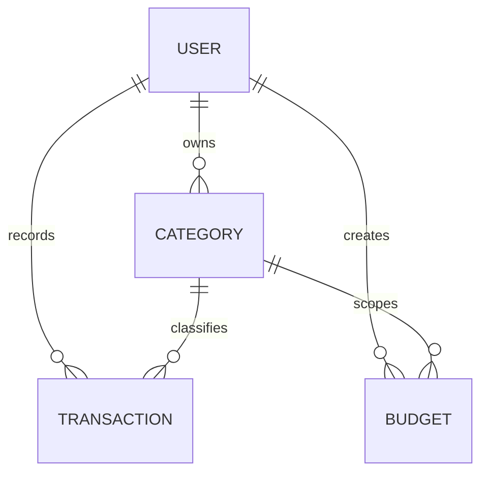

# Database design

MongoDB collections are represented by Mongoose schemas with timestamps and explicit validation.

`User` stores display name, normalized unique email, bcrypt hash (excluded by default), currency and timezone. `Category` is referenced rather than embedded so it can be renamed/deactivated independently; `(owner,type,normalizedName)` is unique. `Transaction` stores `amountMinor` as an integer, currency, type, category, description, date, method and notes. Indexes support owner/date and owner/type/date queries. `Budget` stores owner, optional expense category, monthly year/month and amount; `(owner,category,year,month)` is unique and usage is aggregated from transactions rather than duplicated.

All reads, updates and deletes include the owner predicate. Request validation and schema validation are complementary: authorization is still enforced at query time. Default categories are copied per user during registration, allowing safe customization.

Timezone decision: transaction instants are stored as BSON dates and reports currently use UTC month boundaries for deterministic behavior. Currency decision: one preferred display currency per user; no exchange-rate conversion is attempted. Account deletion permanently deletes the user's categories, transactions and budgets.
