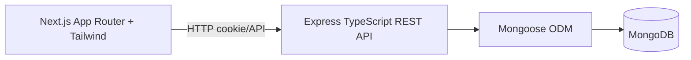

# SpendWise — Personal Finance Tracker

## 1. Title page

Student name: `[Fill in]` · Roll number: `[Fill in]` · Course/Department: `[Fill in]` · Institution: `[Fill in]` · Supervisor: `[Fill in]` · Academic year: `[Fill in]` · Submission date: `[Fill in]`

## 2. Declaration and acknowledgement templates

This project is submitted as an academic implementation. Student declaration, certificate wording, and acknowledgement must be completed and signed only by the student and institution; no approval is implied here.

## 3. Abstract

SpendWise is a manual personal-finance recordkeeping application. Authenticated users record income and expense transactions, organize them by categories, create monthly budgets, and inspect cash-flow summaries. An Express/Mongoose API enforces validation and ownership while a Next.js interface provides responsive access.

## 4–6. Background, objectives and scope

The system addresses fragmented spreadsheet or memory-based tracking. Its scope is manual records, summaries, budgets and exports. It deliberately excludes bank synchronization, payment processing, investment advice, tax advice and automated exchange rates.

## 7. Requirements and 8. Feasibility

Functional requirements cover authentication, CRUD operations, reporting, filtering, CSV export and account deletion. Node.js, MongoDB and a modern browser are sufficient for local operation; Atlas and common Node hosts are practical deployment options.

## 9. Architecture

The browser never accesses MongoDB. API middleware handles security headers, CORS, rate limiting, authentication, validation and centralized errors.

## 10–13. UI, workflows and data flow

Pages include login/register, dashboard, transactions, budgets, categories, reports and settings. Registration creates default per-user categories. Transaction totals and budget usage are generated from stored records. Empty states are explicit and no fabricated financial totals are shown.

## 14. Database design

See [DATABASE_DESIGN.md](DATABASE_DESIGN.md) for fields, indexes, relationships, integer minor-unit money handling, timezone/currency decisions and the ER diagram.

## 15–18. Modules and implementation

Authentication uses bcrypt and short-lived JWTs in HTTP-only cookies. Routes use Zod request schemas and owner-scoped Mongoose queries. Dashboard and report endpoints use aggregation. CSV export quotes commas, quotes and line breaks. The frontend calls the API with credentials and offers responsive navigation.

## 19. Testing and results

Focused utility tests cover minor-unit formatting, month boundaries and CSV escaping. Actual test status must be filled from commands run in the current environment; no unexecuted result is claimed.

| Case | Expected | Actual/status |
|---|---|---|
| Register/login | Cookie and safe user | `[Run and record]` |
| Cross-user access | 404/401, no data leak | `[Run and record]` |
| Amount validation | Reject zero/negative | `[Run and record]` |
| Dashboard totals | Match known fixtures | `[Run and record]` |
| CSV escaping | Valid quoted CSV | `[Run and record]` |

Screenshot placeholders: `[login] [dashboard] [transactions] [budgets] [reports] [mobile]`.

## 20. Installation and user guide

Install Node 20+, MongoDB, copy `.env.example` to `.env`, install both workspaces, run `npm run dev`, register, add transactions, create budgets and review reports. Run `npm run typecheck`, `npm test` and `npm run build`. Seed fictional data with `npm run seed --prefix backend` after adding the optional script documented in README.

## 21–23. Limitations, future work and conclusion

The MVP is manual, single-currency per profile, UTC-period based, and has no bank integration or advice. Future enhancements include recurring transactions, savings goals, receipt OCR, validated CSV import and reminders. The implementation demonstrates full-stack separation, Mongoose validation, ownership authorization and integer-safe totals.

## 24. References

Official documentation: [Express](https://expressjs.com/), [Mongoose](https://mongoosejs.com/docs/), [MongoDB](https://www.mongodb.com/docs/), [Next.js](https://nextjs.org/docs), [OWASP](https://owasp.org/www-project-top-ten/), [Vitest](https://vitest.dev/).

## 25. Submission checklist

- [ ] Fill personal/institutional placeholders and obtain signatures where applicable.
- [ ] Run and record actual tests/build/typecheck results.
- [ ] Add screenshots from the running app.
- [ ] Configure production secrets and deployment URLs only if actually deployed.
- [ ] Review timezone, currency and deletion policy with supervisor.
